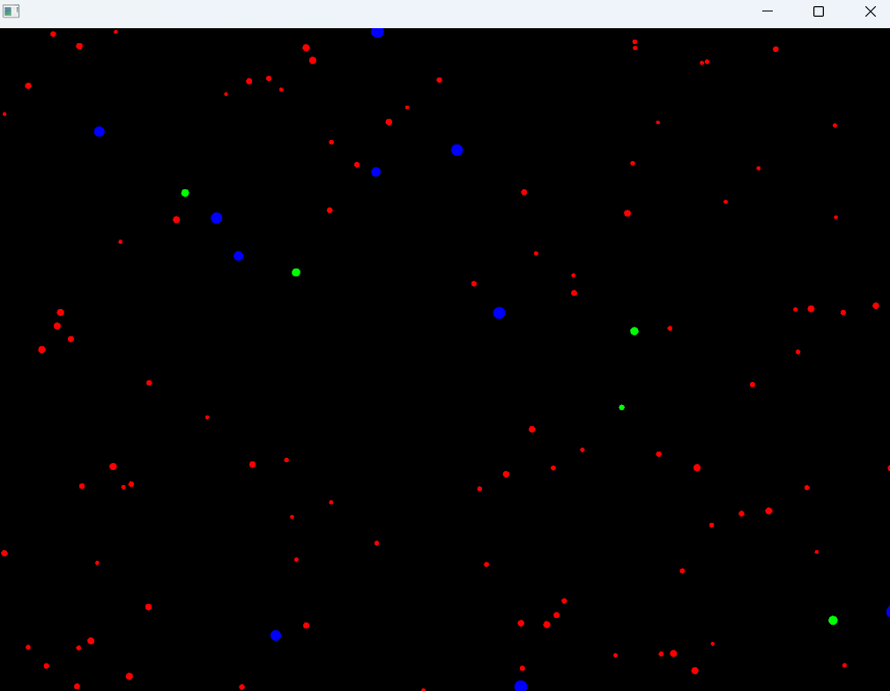
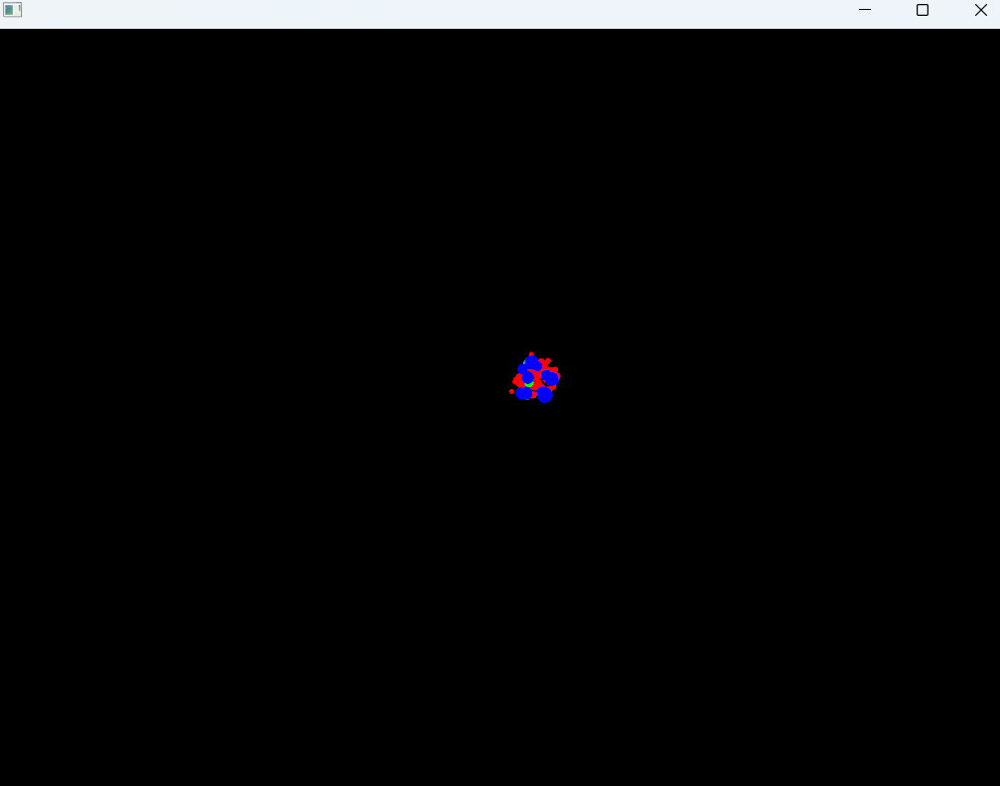
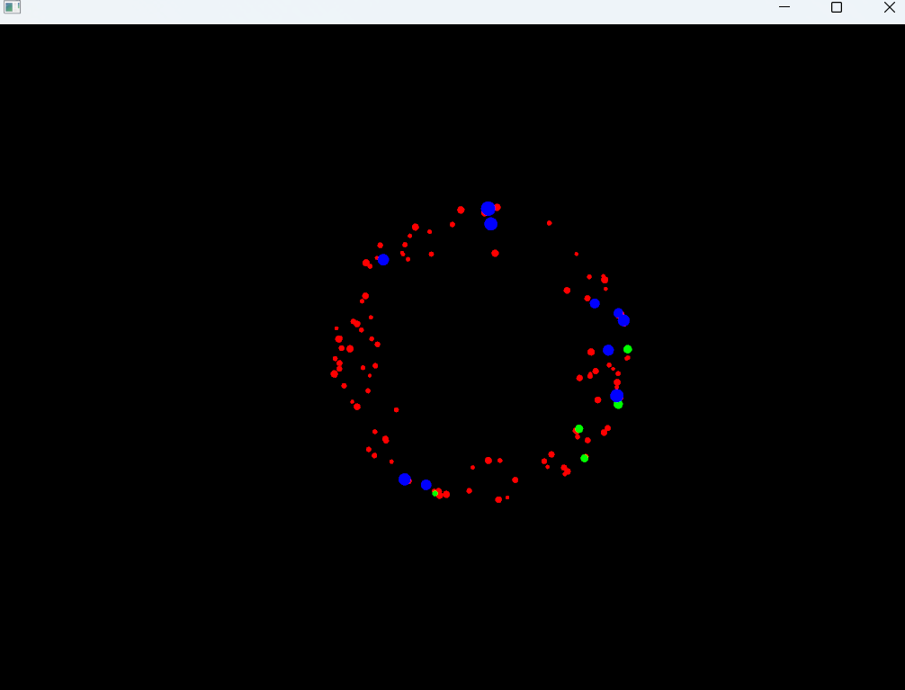
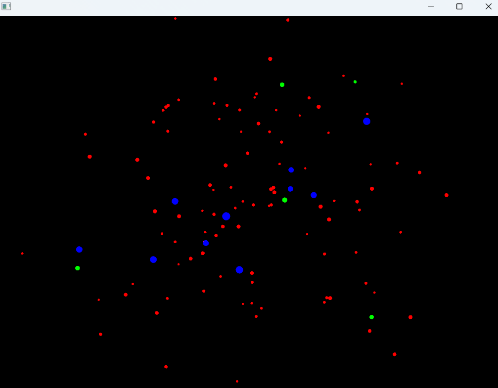
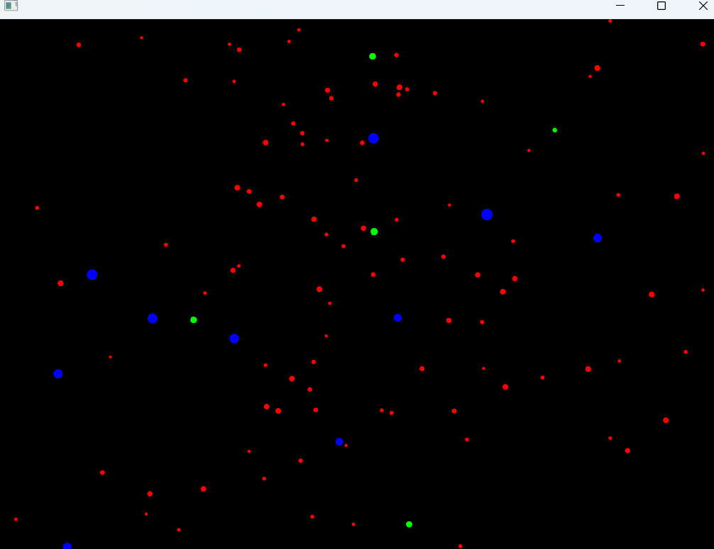

## Actividad 8: Enunciado
### Preguntas de bitácora

```
1. ¿Cómo puedes interactuar con la aplicación? Menciona específicamente
las teclas y qué efecto parecen tener sobre las partículas.
```
Puedes interactuar con el teclado. S para pausarlo, A para que las partículas se atrigan
hacia el mouse, R para que se repelen o alejen del mouse y N para que vuelvan a su estado
normal. 


---
```
2. ¿Observas los diferentes tipos de “partículas”?
¿Se comportan todas igual inicialmente?
```
Partícula azul: planet
Partícula verde: shooting star
Partícula roja: star

---
```
3. Toma algunas capturas de pantalla de la aplicación en diferentes momentos
(estado inicial, después de presionar ‘a’, ‘r’, ‘s’, ‘n’) y añádelas a tu bitácora.
```
## Inicio

---
## Atraer

---
## Repeler

---
## Pausar				

---
## Normal

---

---
```
4. ¿Qué crees que está pasando “detrás de cámaras” cuando presionas las teclas?
Formula una hipótesis inicial sobre cómo la aplicación cambia el comportamiento de las partículas.
```
El programa cambia el comportamiento de las partículas dependiendo de la tecla. Si se presiona A, el programa comprueba si
el mouse está dentro de la ventana y si es así, usa un true para que las partículas se atraigan hacia el mouse. Lo mismo con las demás teclas,
hay condiciones que cambian el comportamiento de las partículas dependiendo de la tecla presionada.

---
