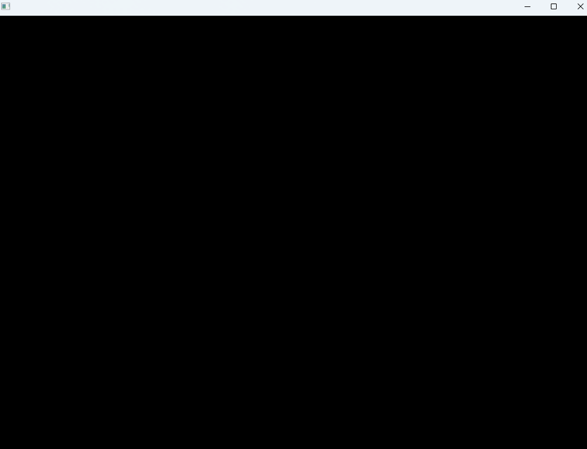
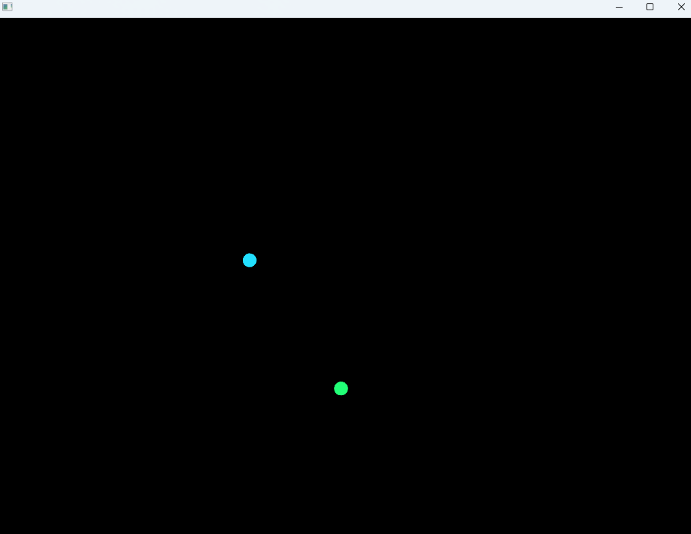
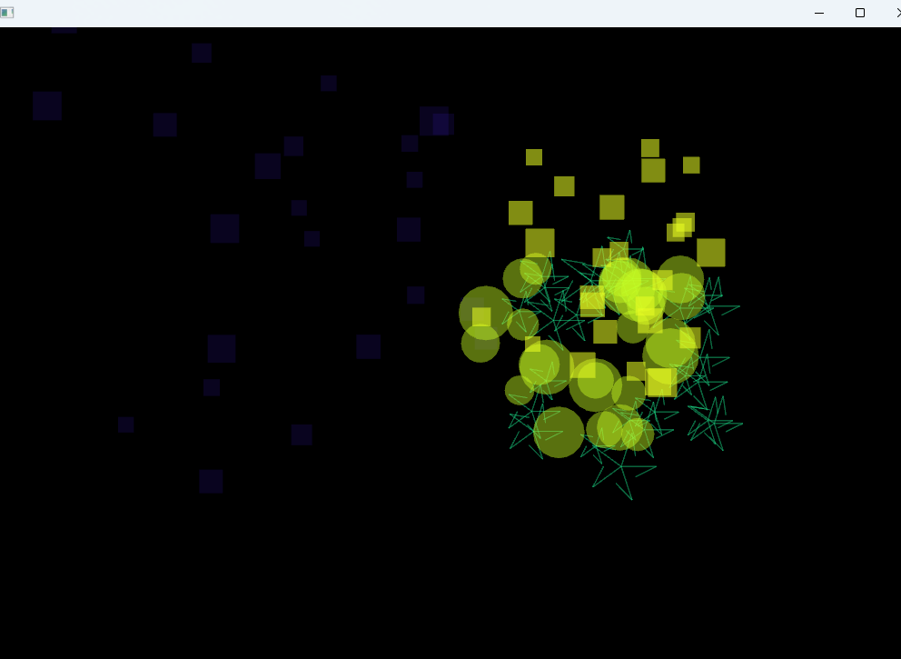
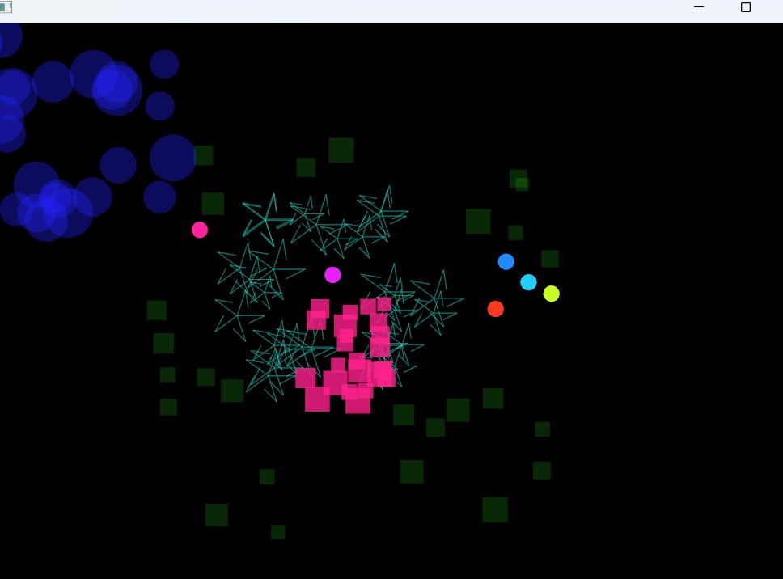
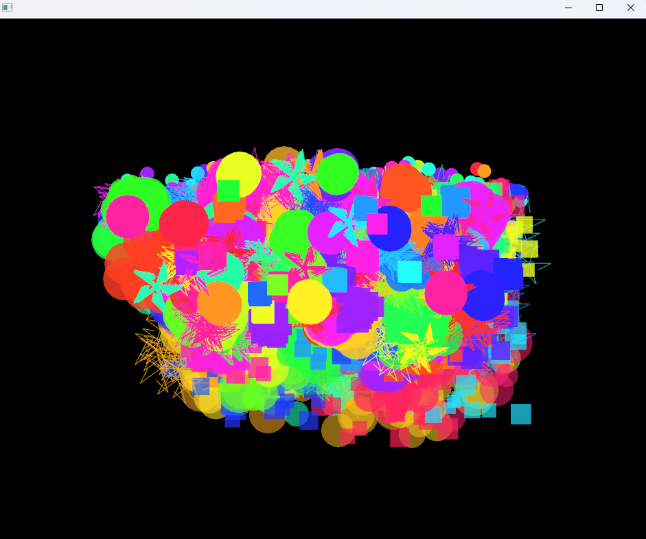

## Actividad 2: Unidad 3
### Partículas
```
 "Analiza el código de la aplicación y trata de explicar en tus propias palabras qué está haciendo, NO USES IA generativa.
 Captura pantallas de la aplicación funcionando y añádelas a la bitácora de aprendizaje."
```

Pude observar que la app muestra un sistema de fuegos artificiales, donde se pueden crear, modificar y eliminar partículas.
Cada partícula tiene propiedades como posición, velocidad y color. La aplicación permite al usuario interactuar con estas partículas a través de una interfaz gráfica,
mostrando cómo se mueven y cambian con el tiempo según las físicas implementadas,muestra como el usuario puede experimentar con pocas o muchas partículas al tiempo

No sé si lo que se pide es una explicación más técnica tipo: al dar clic, se crea un objero ```RisingParticle```, el método ```update()``` modifica posición, etc etc...
Pero puedo escribirlo brevemente según lo que puedo leer:

- La partícula recibe una posición, dirección, velocidad, color y tiempo de vida que no están definidos, es decir, son al azar.

- ```update*()``` como dije antes, modifica la posición y su "edad".
RisingParticle cambua la posición hacia arriba progresivamente para simular gravedad, y cuando detecta que está por la zona superior de la ventana o cuando se le acaba el tiempo de vida, el atributo que tiene ```exploded``` cambia a ```true```.

- Ya cuando explota entonces ```ofApp``` xcrea al rededor de 20 a 29 objetos nuevos. Se escoge aleatoriamente entre ```CircularExplosion, RandomExplosion y StarExplosion```.

- Las partículas que salen de explosión pierden transparecia a medida que aumenta la edad. Al final, se eliminan dle vector y se libera la memoria que usaban.

- Cuando presionas la tecla espacio se crean 1000 partículas. Al presionar la tecla S se toma captura de pantalla.

- Y ya pues los objetos se crean con el ```new``` y se eliminan con ```delete```. 

----
## Capturas












