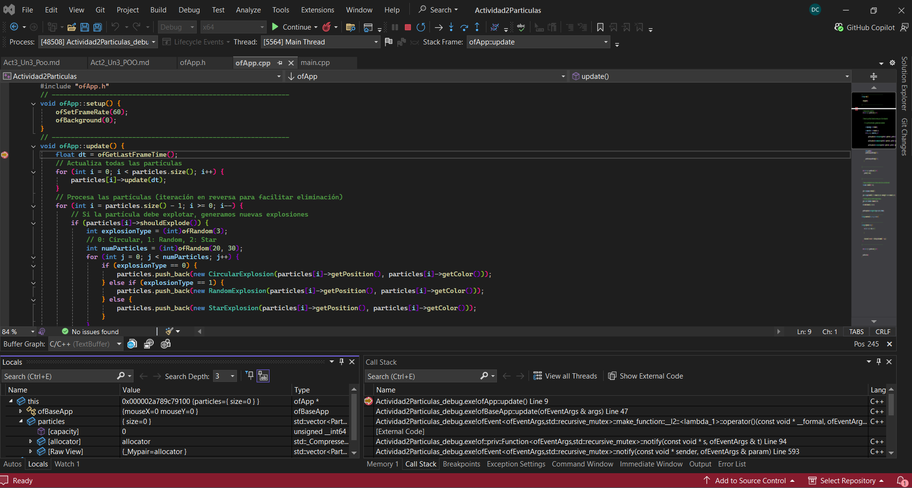
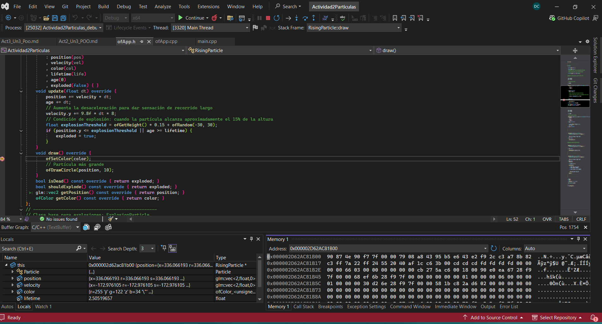
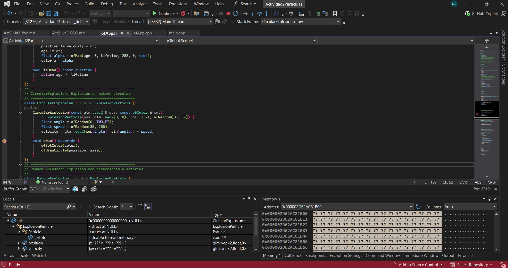
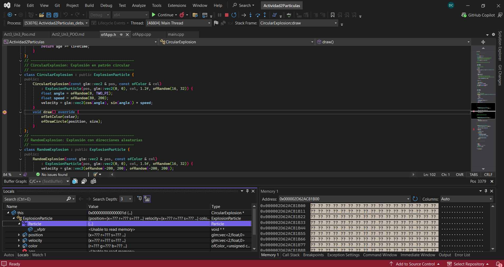

## Actividad 3: Unidad 3
### Experimento con el objeto ofApp
```
 "Antes de ejecutar el experimento, ¿Qué esperas ver en memoria (hipótesis)? Ejecuta el código y
 muestra una captura de pantalla del objeto en la memoria.
 ¿Qué puedes observar? ¿Qué información te proporciona el depurador? ¿Qué puedes concluir?"
```
 se puede observar que en la memoria hay una instancia de ```ofApp``` con la parte heredada de ```ofBaseApp``` y el atributo ```particles```.
 Vemos que ```particles``` es un vector emtpmces el objeto ```ofApp``` no tiene directamente toodas las partículas, sino la información para acceder un arreglo dinámico.
 vemos ```update() draw() y keyPressed()```que no van a salir como datos dentro de cada objeto, sino que son compartidos por todos los objetos de la clase.

---

```
Usa de nuevo el depurador para capturar un objeto de tipo CircularExplosion. Es posible que tengas que hacer modificaciones mínimas en el código para que puedas capturar este objeto más fácilmente.
Observa con el depurador la ventana de Auto o Locals y la ventana de Memory 1. Trata de buscar en memoria todas las partes que componen al objeto tipo CircularExplosion ¿Qué puedes observar en la memoria?
¿Qué información te proporciona el depurador? ¿Qué puedes concluir? NO OLVIDES tener a la mano toda la jerarquía de clases que componen a CircularExplosion.
De esta manera podrás identificar cada parte del objeto en memoria.
```

Le puse un BreakPoint a la altura de ```float dt = ofGetLastFrameTime();```
Ah´´i vemos que ofApp contiene la parte heredada de ofBaseApp y el vector particles. No almacena todas las partículas, sino punteros hacia objetos que están en otras direcciones de memoria.
un objeto contiene principalmente su estado y la información necesaria para reconocer su tipo y acceder a sus funciones, mientras que el código de los métodos es compartido por las instancias.

---

```
Captura la _vtable de un objeto CircularExplosion, pega la imagen en tu bitácora, pero observa detenidamente la tabla de funciones.
¿Qué puedes observar?
```

CicularExplosion se ve como un solo objeto que contiene la parte heredada de Particle. los atributos de posición, velocidad, edad, color, tiempo de vida,tamaño están todos dentro del mismo bloque de memoria.
CircularExplosion no agrega nuevos atrbutos, pero si hay una implementación propía de draw().


La tabla contiene direcciones hacia las implementaciones que deben utilizarse para un objeto de tipo CircularExplosion. Algunas funciones corresponden a métodos heredados, como ExplosionParticle::update(), mientras
que draw() corresponde a la versión sobrescrita por CircularExplosion. Esto indica que el objeto puede reutilizar comportamientos de sus clases base y reemplazar solamente los métodos necesarios.

---
```
Ahora, captura en memoria la _vtable de un objeto StarExplosion, pega la imagen en tu bitácora y observa detenidamente la tabla de funciones.
```


---

```
Observa de nuevo ambas tablas y compara. ¿Qué puedes ver? ¿Qué puedes concluir?
¿Qué relación existe entre la tabla de funciones y los métodos virtuales? Esta pregunta que te voy a hacer no es fácil y la idea de hacerla es prepararte mentalmente para lo viene
¿Para qué crees que pueda servir una tabla de funciones virtuales? Para responder esta pregunta trata de pensar en el polimorfismo con interfaces y clases abstractas que viste al estudiar C#.
Nota que el método HacerSonido se llama dos veces, una vez para el perro y otra vez para el gato. ¿Cómo se logra esto? ¿Qué relación existe entre los métodos virtuales y el polimorfismo?
Al llamar HacerSonido cómo sabe esta función sobre cuál objeto debe actuar?
```
Las tablas de CircularExplosion y StarExplosion tienen una estructura semejante porque ambas clases heredan de ExplosionParticle. Varias entradas apuntan a las mismas funciones heredadas. Sin embargo, la entrada
correspondiente a draw() cambia, porque cada clase sobrescribe ese método con una implementación diferente. Concluyo que una clase derivada puede conservar métodos de su clase base y reemplazar solamente determinadas posiciones de la tabla virtual.

Latabla virtual permite seleccionar la implementación correcta de un método según el tipo real del objeto. El vector puede almacenar todos los elementos como Particle* y llamar update() o draw() de la misma manera.
El sistema consulta la tabla del objeto y ejecuta la versión apropiada. Esta selección durante la ejecución es la base del polimorfismo dinámico.


