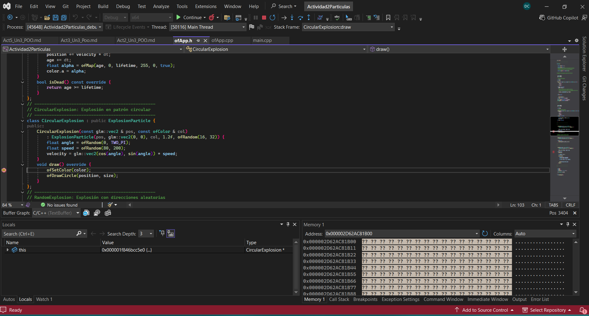

## Actividad 5
### Encapsulamiento
---

```
captura de nuevo la memoria que ocupa el objeto CircularExplosion compara la jerarquía de clases con los campos en memoria del objeto.
¿Qué puedes observar? ¿Qué información te proporciona el depurador? ¿Qué puedes concluir?

¿Cómo se implementa la herencia en C++?

C++ permite hacer algo que C# no: herencia múltiple. Realiza un experimento que te permita ver cómo se objeto en memoria cuya clase base tiene herencia múltiple.
```

Al detener la aplicación dentro de CircularExplosion::draw(), el puntero this identificó un objeto real de tipo CircularExplosion. Al expandirlo en el depurador encontré la parte heredada de ExplosionParticle y, dentro de ella, la parte correspondiente a Particle.
Los atributos position, velocity, color, age, lifetime y size fueron declarados en ExplosionParticle, pero forman parte del objeto completo CircularExplosion. Esto permite que la clase derivada los utilice sin volver a declararlos.
También observé que CircularExplosion no agrega atributos propios. Su especialización está principalmente en el método draw() y en la configuración de la velocidad realizada por su constructor. Concluyo que la herencia permite construir un objeto especializado a partir
de una clase más general, incorporando las partes de las clases base dentro de una sola instancia.



En C++, la herencia se declara escribiendo la clase base después de dos puntos, como en class CircularExplosion : public ExplosionParticle. La parte correspondiente a la clase base se incorpora al objeto derivado. Los atributos heredados forman parte de la memoria
del objeto y los métodos de la clase base pueden reutilizarse.


---
