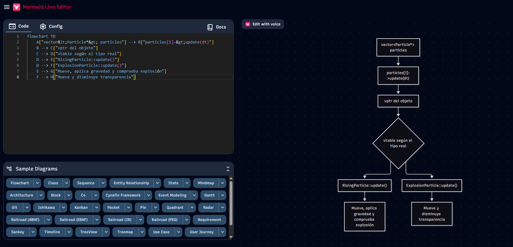

## Actividad 6
### Polimorfismooo

```
    // Actualiza todas las partículas
    for (int i = 0; i < particles.size(); i++) {
		    particles[i]->update(dt);
		    }
```
```
¿Qué puedes observar? ¿Qué información te proporciona el depurador?
```
Al utilizar el depurador observé que todos los elementos del vector son tratados como punteros Particle*, pero cada puntero puede señalar un objeto de una clase derivada diferente.
La llamada particles[i]->update(dt) ejecuta RisingParticle::update() cuando el objeto real es una partícula ascendente y ExplosionParticle::update() cuando se trata de una partícula de explosión.
Esto demuestra que la función seleccionada depende del tipo real del objeto durante la ejecución y no solamente del tipo declarado del puntero.
El depurador me permitió comparar el tipo estático del puntero con el tipo dinámico del objeto.

----

```
Realiza un dibujo con el cuál expliques cómo se implementa el polimorfismo en tiempo de ejecución.
Utiliza el concepto de métodos virtuales y la tabla de funciones virtuales. ¿Qué puedes concluir?
```

El polimorfismo en tiempo de ejecución se implementa mediante métodos virtuales y una tabla de funciones virtuales. Cada objeto tiene asociado un puntero hacia la tabla correspondiente a su tipo real.
Cuando se llama update() mediante un Particle*, el programa consulta esa tabla y encuentra la implementación adecuada. Por eso la misma instrucción puede ejecutar funciones diferentes.

---


```
¿Qué relación existe entre los métodos virtuales y el polimorfismo?
```
Los métodos virtuales permiten que una función llamada mediante un puntero de clase base ejecute la implementación correspondiente al tipo real del objeto. Esta selección dinámica constituye el polimorfismo en tiempo de ejecución.
La vtable almacena las direcciones de las implementaciones y permite que objetos diferentes respondan de formas distintas ante una misma llamada.


---
