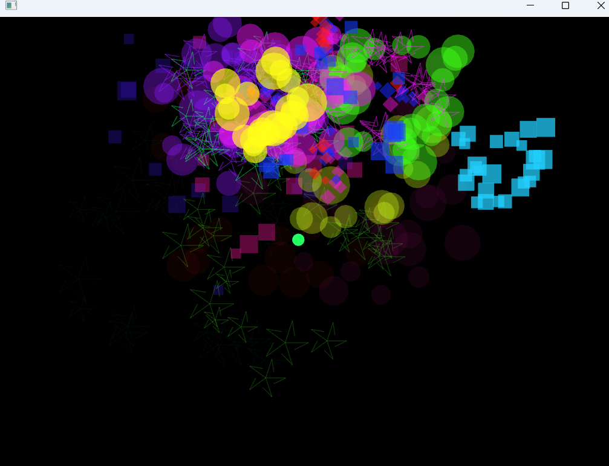
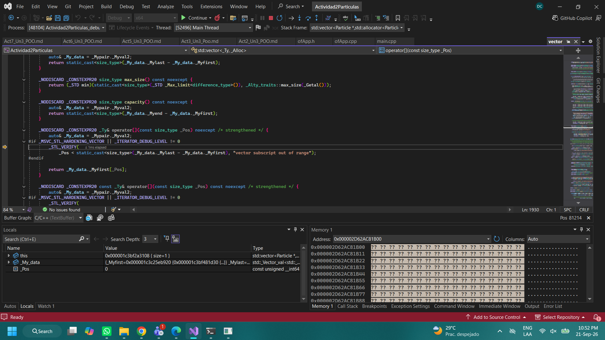

## Actividad 6
### Aplicar lo aprendido
---



```
¿Cómo y por qué de la implementación de cada una de las extensiones solicitadas al caso de estudio?
```

- El zig zag
porque permite observar fácilmente un comportamiento distinto al de RisingParticle. También se dibuja como un triángulo para que pueda identificarse visualmente mientras la aplicación se ejecuta.
- El Espiral
Elegí este comportamiento porque es claramente diferente tanto de la trayectoria recta de RisingParticle como del cambio de dirección de ZigZagParticle.
- Explosion en Cruz
La clase hereda de ExplosionParticle para reutilizar los atributos de posición, velocidad, color, edad, tiempo de vida y tamaño, además del comportamiento que mueve y desvanece los fragmentos.

 
---
```
¿Cómo y por qué de la implementación de los conceptos de encapsulamiento, herencia y polimorfismo en tu código?
```

-Implementé el encapsulamiento declarando como privados los atributos internos de ZigZagParticle y SpiralParticle. De esta manera, la posición, velocidad, edad y estado de explosión solamente pueden modificarse mediante los métodos de la propia clase. ofApp
consulta únicamente la posición, el color y el estado mediante métodos públicos. Esto evita que otras partes del programa cambien sin cuidado el estado de las partículas.

-Implementé la herencia haciendo que las dos partículas nuevas derivaran de Particle. Esto obliga a que cumplan el contrato definido por la clase base e implementen update(), draw() e isDead(). CrossExplosion deriva de ExplosionParticle porque comparte los datos
y el comportamiento general de las explosiones. De esta manera reutiliza el movimiento, el desvanecimiento y la condición de muerte, y solamente necesita definir su velocidad inicial y su forma de dibujo.

- Implementé el polimorfismo almacenando todas las clases mediante punteros Particle*. Aunque el vector utiliza un tipo base común, cada objeto ejecuta su propia implementación de update() y draw(). Esto permite agregar nuevas partículas sin crear ciclos separados
- ni preguntar manualmente qué tipo tiene cada objeto.

---
```
Explica cómo verificaste que cada una de las extensiones funciona correctamente, muestra capturas de pantalla del depurador donde evidencias lo anterior, en particular el polimorfismo en tiempo de ejecución.
```


