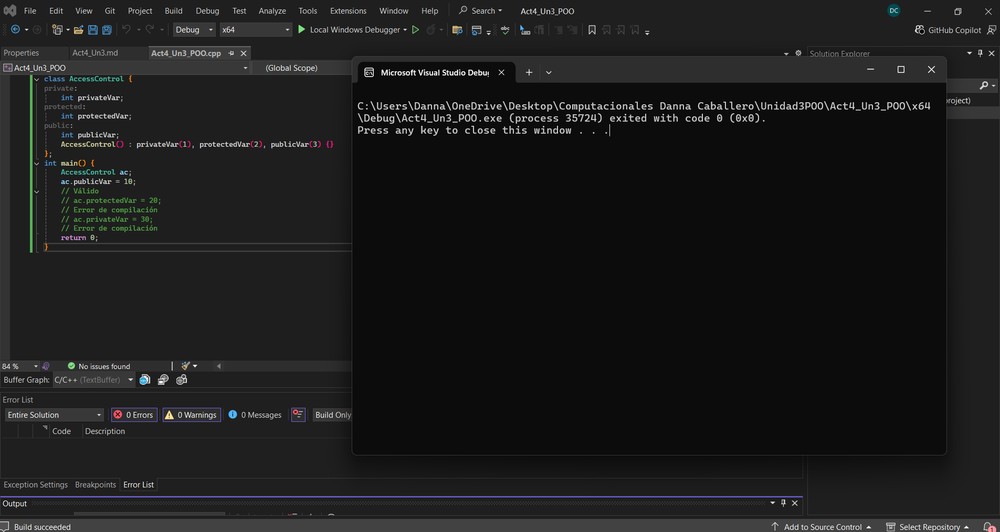
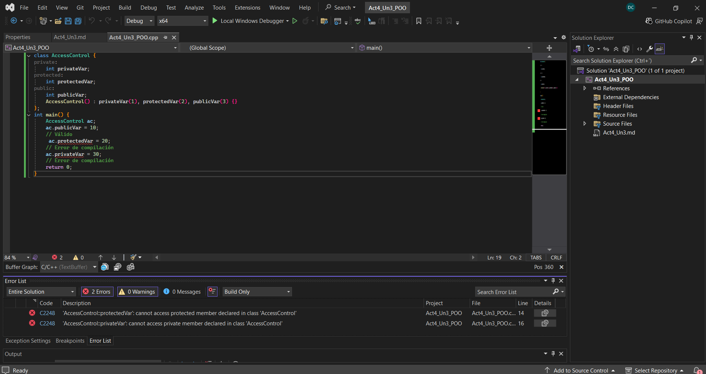

## Actividad 4
### Encapsulamiento error

```
//Primer Código
class AccessControl {
private:
	int privateVar;
protected:
	int protectedVar;
public:
	int publicVar;
	AccessControl() : privateVar(1), protectedVar(2), publicVar(3) {}
};
int main() {
	AccessControl ac;
	ac.publicVar = 10;
	// Válido
	// ac.protectedVar = 20;
	// Error de compilación
	// ac.privateVar = 30;
	// Error de compilación
	return 0;
}
```

```
Ejecuta este código.
Luego, descomenta las líneas que están comentadas y vuelve a compilar.
¿Qué sucede? ¿Por qué sucede esto? ¿Qué puedes concluir?
```

Al ejecutar el primer código comprobé que publicVar puede modificarse desde main(), debido a que fue declarado como público.
Cuando descomenté las líneas correspondientes a protectedVar y privateVar, el programa dejó de compilar. Esto sucede porque main() está fuera de la clase y no tiene permiso para utilizar directamente miembros protegidos o privados.
Concluyo que los modificadores de acceso permiten controlar qué partes del programa pueden consultar o modificar el estado de un objeto.





---

```
//Segundo Código
#include <iostream>
class MyClass {
private:
		int secret1;
		float secret2;
		char secret3;
public:
		MyClass(int s1, float s2, char s3) : secret1(s1), secret2(s2), secret3(s3) {}
    void printMembers() const {
		    std::cout << "secret1: " << secret1 << "\n";
		    std::cout << "secret2: " << secret2 << "\n";
		    std::cout << "secret3: " << secret3 << "\n";
		    }
		};

int main() {
		MyClass obj(42, 3.14f, 'A');
		// Esta línea causará un error de compilación
		std::cout << obj.secret1 << std::endl;
    obj.printMembers();
    // Método público para mostrar los valores
    return 0;
    }
```

```
Compila el programa. ¿Qué pasa?
```

Al intentar imprimir obj.secret1 directamente, el compilador produjo un error porque el atributo fue declarado como privado. 
Sin embargo, después de comentar esa instrucción, el método público printMembers() pudo mostrar los tres valores. Esto demuestra que los datos 
privados sí existen dentro del objeto, pero solamente pueden utilizarse normalmente a través de los métodos autorizados por la clase.

.png)

---

```

// Tercer Código
#include <iostream>
class MyClass {
private:
	int secret1;
	float secret2;
	char secret3;
public:
	MyClass(int s1, float s2, char s3) : secret1(s1), secret2(s2), secret3(s3) {}
	void printMembers() const {
		std::cout << "secret1: " << secret1 << "\n";
		std::cout << "secret2: " << secret2 << "\n";
		std::cout << "secret3: " << secret3 << "\n";
	}
};
int main() {
	MyClass obj(42, 3.14f, 'A');
	// Usando reinterpret_cast para violar el encapsulamiento
	int* ptrInt = reinterpret_cast<int*>(&obj);
	float* ptrFloat = reinterpret_cast<float*>(ptrInt + 1);
	char* ptrChar = reinterpret_cast<char*>(ptrFloat + 1);
	// Accediendo y mostrando los valores privados
	std::cout << "Accediendo directamente a los miembros privados:\n";
	std::cout << "secret1: " << *ptrInt << "\n";
	// Accede a secret1
	std::cout << "secret2: " << *ptrFloat << "\n";
	// Accede a secret2
	std::cout << "secret3: " << *ptrChar << "\n";
	// Accede a secret3
	return 0;
}
```

```
Compila el programa y ejecuta. ¿Qué puedes concluir?
En tus palabras, ¿Qué es el encapsulamiento? ¿Por qué es importante?
```
- El tercer experimento demuestra que los atributos privados continúan almacenados físicamente en la memoria del objeto.
l obtener la dirección del objeto y calcular las posiciones de sus atributos, fue posible leer los valores mediante punteros.

- El encapsulamiento es el principio de agrupar los datos y los métodos relacionados dentro de una clase y controlar cuáles elementos pueden utilizarse desde el exterior.
- Los atributos internos suelen declararse como privados o protegidos
- El encapsulamiento es importante porque: Impide modificaciones accidentales, valida nuevos valores, proteger consistencia del objeto, define claramente las clases.

 .png)

----


