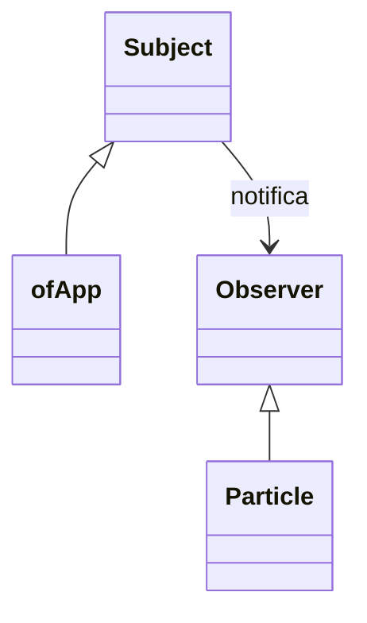
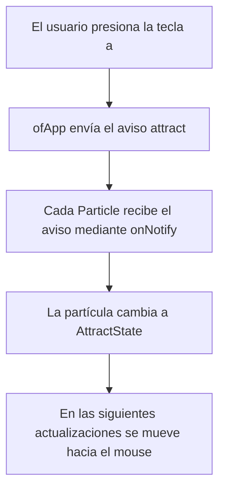

## Actividad 9: Investiga el patrón Observer

### 1. Explica con tus propias palabras el propósito del patrón Observer. ¿Qué problema resuelve?

Permite que un objeto avise a otros cuando ocurre algo. En esta aplicación, ofApp avisa a las partículas cuando se presiona una tecla y ellas cambian su comportamiento.
quien envía el aviso no necesita conocer los detalles de cómo responde cada objeto.

---

### 2. Dibuja un diagrama que muestre la relación entre Subject, Observer, ofApp y Particle.



```
(vale aclarar que usé IA para saber como
poner un diagrama en .md)
```

ofApp es el sujeto que envía los avisos y Particle es el observador que los recibe. Subject proporciona las funciones para registrar y notificar, y
Observer define cómo se recibe el aviso.

---
### 3. Secuencia del patrón Observer al presionar una tecla



ofApp es el sujeto que envía el aviso y las partículas son los observadores que lo reciben. Cada partícula cambia su estado al recibir la notificación.

---

### 4. ¿Qué ventajas ofrece Observer frente a controlar las partículas mediante una variable global?

Separa el envío del aviso de la reacción de las partículas. ofApp no necesita controlar directamente cómo cambia cada una. También permite agregar otros
observadores sin cambiar la forma de enviar las notificaciones. Esto facilita ampliar y mantener el programa.
